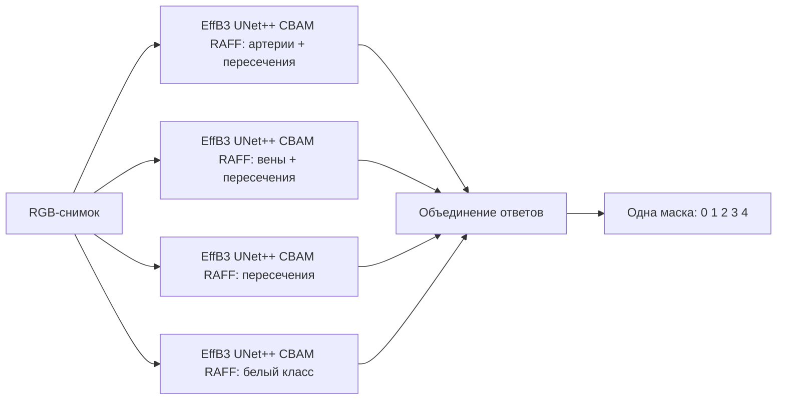

# Одна итоговая модель: четыре бинарных RIVER-эксперта

`UNetPlusPlusEffB3RiverEnsemble` — одна модель для pipeline:
один вызов `fit()`, один `predict()`, один checkpoint на fold.
Внутри находятся четыре независимые сети EfficientNet-B3 + UNet++ + CBAM + RAFF.
Они обучаются отдельно и вместе формируют **одну маску с ID 0–4**.

| Эксперт | Положительные исходные ID | Что учит |
| --- | --- | --- |
| `arteries_crossings` | 1, 3 | Артериальное русло вместе с пересечениями |
| `veins_crossings` | 2, 3 | Венозное русло вместе с пересечениями |
| `crossings` | 3 | Области пересечений |
| `class4` | 4 | Белый класс исходной разметки |

Фон — ID 0. Остальные ID отрицательны для соответствующего эксперта.
Белый эксперт добавлен, чтобы итоговая модель сохраняла все пять исходных классов.

Это **ансамбль четырёх сетей** с одним интерфейсом и итоговым результатом.
Параметры сетей не усредняются; каждую задачу решает её обученный эксперт.
Для одной сети с общими параметрами понадобился бы другой эксперимент:
совместное обучение нескольких голов или дистилляция ансамбля.



Модель самостоятельная: собственные `model.py` и `river_attention.py`,
без импорта реализаций UNETPP_EFFB3, BINARY или RIVER.
Речные attention-модули скопированы из предыдущей адаптации и входят
в каждую обучаемую сеть; объединение экспертов описано отдельно ниже.

**Ограничение оценки:** существующий shuffle выбирает исходники с повторениями,
создавая пересечение train и test. Подготовка данных сохранена по условию.
Для достоверного сравнения требуется исправленное разбиение и повторное обучение
baseline и нового ансамбля. Новый runner полностью сохраняет прежнюю процедуру,
кроме двух строк выбора модели.

## Запуск с нуля в Windows PowerShell

Инструкция рассчитана на Windows 10/11, 64-битный Python и PowerShell.
Все команды ниже выполняются из корня проекта, в примерах это `E:\pp2-veins`.
Если проект расположен в другой папке, замените этот путь на свой.
Выполняйте блоки по порядку; при ошибке сначала устраните её.

Нужны папка проекта с `common`, `UNETPP_EFFB3_RIVER_ENSEMBLE` и `run_pipeline_river_ensemble.py`,
а также размеченный датасет. Установленный Python и готовый `.venv` заранее
не требуются. Для установки библиотек и первой загрузки ImageNet weights нужен
интернет. Для обучения рекомендуется NVIDIA GPU; вариант с CPU приведён ниже.
Для ручной проверки используется RTX 3060 с 12 ГиБ памяти.

### 1 Установите Python

Откройте [страницу Python 3.12.10](https://www.python.org/downloads/release/python-31210/),
найдите раздел Files и скачайте **Windows installer (64-bit)**.
Это версия Python, использованная для проверки модели.

Запустите установщик, включите **Add python.exe to PATH** и установку launcher
`py`, затем выберите **Install Now**. После установки откройте новое окно
PowerShell и проверьте:

```powershell
py -3.12 --version
```

Ожидается `Python 3.12.10`. Если команда `py` не найдена, закройте и снова
откройте PowerShell. Если это не помогло, повторно запустите установщик Python
и включите Python Launcher.

### 2 Откройте папку проекта

Получите папку проекта с кодом и данными, например распакуйте предоставленный
архив в `E:\pp2-veins`. Затем выполните:

```powershell
Set-Location -LiteralPath 'E:\pp2-veins'
Get-Location
Test-Path -LiteralPath '.\run_pipeline_river_ensemble.py'
Test-Path -LiteralPath '.\UNETPP_EFFB3_RIVER_ENSEMBLE\requirements.txt'
```

Две последние команды должны вывести `True`. Не запускайте обучение из папки
`UNETPP_EFFB3_RIVER_ENSEMBLE`: относительные пути результатов рассчитаны на корень проекта.

### 3 Создайте виртуальное окружение

`.venv` — отдельная папка с Python и библиотеками этого проекта.
Если её ещё нет, создайте её:

```powershell
py -3.12 -m venv .venv
.\.venv\Scripts\python.exe --version
.\.venv\Scripts\python.exe -c "import sys; print(sys.executable); print('venv:', sys.prefix != sys.base_prefix)"
```

Ожидается путь `E:\pp2-veins\.venv\Scripts\python.exe` и `venv: True`.
Если `.venv` уже существует, работает и использует Python 3.12, создание можно
пропустить. Если в нём другой Python, сохраните старое окружение и создайте
новое командой `py -3.12 -m venv .venv-river-ensemble`. В этом случае во всех дальнейших
командах замените `.venv` на `.venv-river-ensemble`.

Дальнейшие команды прямо вызывают Python из `.venv`, поэтому активация
не обязательна. Такой способ описан в [документации Python venv](https://docs.python.org/3.12/library/venv.html)
и работает независимо от разрешения запускать `Activate.ps1`.

### 4 Установите PyTorch

Сначала обновите pip внутри созданного окружения:

```powershell
.\.venv\Scripts\python.exe -m pip install --upgrade pip
```

Выберите **один** из двух вариантов установки PyTorch.
Команды соответствуют [официальной инструкции для PyTorch 2.7.1](https://pytorch.org/get-started/previous-versions/#v271).

**Вариант A — NVIDIA GPU**, в том числе RTX 3060 из проверенной конфигурации.
Установите актуальный драйвер своей видеокарты с
[сайта NVIDIA](https://www.nvidia.com/en-us/drivers/) и проверьте, что система
её видит:

```powershell
nvidia-smi
```

После этого установите PyTorch с CUDA 12.8:

```powershell
.\.venv\Scripts\python.exe -m pip install torch==2.7.1 torchvision==0.22.1 --index-url https://download.pytorch.org/whl/cu128
```

**Вариант B — CPU**, если совместимой NVIDIA GPU нет:

```powershell
.\.venv\Scripts\python.exe -m pip install torch==2.7.1 torchvision==0.22.1 --index-url https://download.pytorch.org/whl/cpu
```

Модель выбирает CPU автоматически, когда CUDA недоступна. Полное обучение
на CPU обычно существенно медленнее.

### 5 Установите остальные зависимости

Используйте файл с версиями, проверенными для новой модели:

```powershell
.\.venv\Scripts\python.exe -m pip install -r .\UNETPP_EFFB3_RIVER_ENSEMBLE\requirements.txt
.\.venv\Scripts\python.exe -m pip check
```

`pip check` должен вывести `No broken requirements found`.
Файл содержит также выбранные версии torch и torchvision: уже установленная
сборка `2.7.1+cu128` или `2.7.1+cpu` удовлетворяет записи `torch==2.7.1`.
Корневой `requirements.txt` менять не требуется.

Проверьте окружение и импорт модели:

```powershell
$env:NO_ALBUMENTATIONS_UPDATE = '1'
.\.venv\Scripts\python.exe -c "import torch, segmentation_models_pytorch as smp; from common import settings; from UNETPP_EFFB3_RIVER_ENSEMBLE.model import UNetPlusPlusEffB3RiverEnsemble; print('torch:', torch.__version__); print('SMP:', smp.__version__); print('CUDA:', torch.cuda.is_available()); print('DEVICE:', settings.DEVICE); print('MODEL:', UNetPlusPlusEffB3RiverEnsemble.get_model_name())"
```

Ожидаются SMP `0.5.0` и MODEL `UN-WCD-RIVER-ENSEMBLE`. Для варианта NVIDIA ожидаются
`CUDA: True` и `DEVICE: cuda`; для CPU — `CUDA: False` и `DEVICE: cpu`.
`NO_ALBUMENTATIONS_UPDATE` отключает сетевую проверку новых версий библиотеки
в текущем окне PowerShell; преобразования изображений остаются прежними.

### 6 Подготовьте расположение датасета

Используйте существующие изображения и RGB-маски. Структура папок:

```text
E:\pp2-veins\
    run_pipeline_river_ensemble.py
    common\
    UNETPP_EFFB3_RIVER_ENSEMBLE\
        model.py
        river_attention.py
        requirements.txt
    dataset\
        images\
            001_G.png
            002_N.png
            ...
        masks\
            001_G.png
            002_N.png
            ...
```

Для каждого изображения нужен файл маски с тем же именем. Загрузчик использует
PNG из `dataset/images` и `dataset/masks`; JPG, отдельные папки train/test
или внешние датасеты этот runner не подхватывает. При исходных настройках
`FOLDS_NUM=3` и `TEST_SIZE=20` требуется не менее **60 пар**.

Цвета RGB-маски должны соответствовать `common/settings.py`:

| Класс | RGB |
| --- | --- |
| Фон | `(0, 0, 0)` |
| Артерии | `(255, 0, 0)` |
| Вены | `(0, 0, 255)` |
| Пересечения | `(0, 255, 0)` |
| Белый класс (ID 4) | `(255, 255, 255)` |

Проверьте число файлов и совпадение имён до запуска:

```powershell
.\.venv\Scripts\python.exe -c "from common import settings; images = {p.name for p in settings.DATASET_IMG_DIR.glob('*.png')}; masks = {p.name for p in settings.DATASET_MASK_DIR.glob('*.png')}; print('Images:', len(images)); print('Masks:', len(masks)); print('Required pairs:', settings.FOLDS_NUM * settings.TEST_SIZE); print('Images without mask:', sorted(images - masks)); print('Masks without image:', sorted(masks - images))"
```

Числа Images и Masks должны совпасть и быть не меньше Required pairs.
Оба списка отсутствующих пар должны быть `[]`. В текущем проекте есть 100 пар.
Resize, Normalize, аугментации и создание folds выполняет существующий код;
заранее изменять размеры изображений или переписывать подготовку данных не нужно.

### 7 Запустите итоговую модель

Запускайте из корня проекта:

```powershell
.\.venv\Scripts\python.exe -u .\run_pipeline_river_ensemble.py
```

В runner выбраны `UNetPlusPlusEffB3RiverEnsemble` и `USE_FITTED = False`.
Он повторяет `run_pipeline_6.py`: загрузка folds, fit, save, predict и
исходные пятиclass-метрики. Ground truth для оценки остаётся исходной маской
0–4: пересечения оцениваются как ID 3, белый класс — как ID 4.

В каждом fold `fit()` по очереди учит четыре сети по 50 эпох.
Логи содержат `Expert 1/4`, имя эксперта, положительные ID, counts и веса loss.
При трёх folds это **12 независимых обучений, суммарно 600 эпох**.
Объединённая модель тяжелее исходного UNETPP_EFFB3 по времени обучения и inference.

Пока учится или предсказывает одна сеть, остальные находятся на CPU.
Состояния неактивных Adam также находятся на CPU. Это особенно важно:
существующий runner заранее создаёт три fold-модели, то есть 12 сетей.
Инициализация использует ImageNet weights encoder; первая загрузка требует интернет.

После каждого fold создаётся **один общий файл весов**:

```text
UNETPP_EFFB3_RIVER_ENSEMBLE/
    weights_1.eth
    weights_2.eth
    weights_3.eth
    raw_metrics.csv
    interval_metrics.csv
```

Каждый `weights_N.eth` содержит четыре сети, четыре состояния Adam,
веса loss, список обученных экспертов, пороги и версию правила объединения.
Один checkpoint нужен для одного fold; три файла соответствуют прежней
трёхfold-оценке, а не трём разным типам сегментации.

Для чтения результатов:

```powershell
Import-Csv -LiteralPath .\UNETPP_EFFB3_RIVER_ENSEMBLE\raw_metrics.csv | Format-Table
```

Повторный запуск с `USE_FITTED = False` перезаписывает результаты этого
ансамбля. Сохраните копию его папки заранее, если старый запуск нужен.

### 8 Загрузите готовый ансамбль

Для штатной оценки нужны все три общих checkpoint. Откройте runner:

```powershell
notepad .\run_pipeline_river_ensemble.py
```

Замените `USE_FITTED = False` на `USE_FITTED = True`, сохраните и запустите:

```powershell
.\.venv\Scripts\python.exe -u .\run_pipeline_river_ensemble.py
```

Загрузится каждый ансамбль целиком, затем будут пересчитаны CSV.
Это оценка готовых весов, а не продолжение прерванного обучения.
Для одной модели вне CV достаточно одного общего checkpoint:

```python
from UNETPP_EFFB3_RIVER_ENSEMBLE.model import UNetPlusPlusEffB3RiverEnsemble

model = UNetPlusPlusEffB3RiverEnsemble(encoder_weights=None)
model.load("UNETPP_EFFB3_RIVER_ENSEMBLE/weights_1.eth")
prediction = model.predict(images)  # CPU long [B,H,W], IDs 0–4
```

Здесь `images` — batch из существующего loader с Normalize и Resize 512,
а не необработанный PNG. `encoder_weights=None` позволяет загрузить
общий checkpoint без предварительного скачивания ImageNet weights.

Веса старой пятиканальной RIVER или прежних plain BINARY моделей
**не подходят**: в них другой состав сетей или отсутствуют CBAM/RAFF.
Добавление случайно инициализированных attention-модулей к готовым весам
не заменяет их обучение. Такие checkpoint явно отклоняются.

### 9 Повторный запуск из нового окна

```powershell
Set-Location -LiteralPath 'E:\pp2-veins'
$env:NO_ALBUMENTATIONS_UPDATE = '1'
.\.venv\Scripts\python.exe -u .\run_pipeline_river_ensemble.py
```

Установку повторять не требуется. Активация необязательна:

```powershell
.\.venv\Scripts\Activate.ps1
python -u .\run_pipeline_river_ensemble.py
```

Если PowerShell блокирует Activate.ps1, используйте полный путь Python.
Выход из активированного окружения — `deactivate`.

### Ошибки запуска

| Симптом | Действие |
| --- | --- |
| `py` не найден | Установите Python 3.12 с launcher и откройте новое окно |
| `.venv\Scripts\python.exe` не найден | Проверьте текущую папку и выполните шаг 3 |
| `No module named ...` | Установите requirements через Python этого venv |
| CUDA недоступна | Проверьте NVIDIA driver и CUDA-сборку torch по шагам 4–5 |
| `CUDA out of memory` | Закройте другие GPU-процессы; при необходимости уменьшите BATCH_SIZE до 4 или 2, учитывая изменение параметров сравнения |
| Закончилась RAM | Не запускайте несколько обучений одновременно: 12 сетей и их Adam snapshots хранятся преимущественно на CPU |
| Ошибка скачивания weights | Проверьте интернет и доступ к хранилищу pretrained weights |
| `Expected a unified four-expert RIVER checkpoint` | Используйте общий checkpoint именно новой архитектуры |
| `Train or load all four experts before predict()` | Завершите обучение или загрузку всех четырёх экспертов; частичный комплект не является готовой моделью |
| `train fold must contain both rest and positive pixels` | В train отсутствует один из двух классов конкретного эксперта; проверьте PNG и цвета |
| Веса не найдены при USE_FITTED=True | Завершите все три folds или перенесите совместимые checkpoint |

## Что действительно взято из речных статей

Основной источник — Tang et al.,
[RAU-Net++: River Channel Extraction Methods for Remote Sensing Images of Cold and Arid Regions](https://www.mdpi.com/2076-3417/14/1/251),
Applied Sciences 2024, DOI `10.3390/app14010251`
([полный текст](https://artefacts-discovery.researcher.life/full_text/DA-2/1b/1b78cee5a8ad325e8b0e66b1c3f87537/full_text/3bfbfa2c3323bc5cd34be5a1b00169a1.pdf)).
Авторы вводят CBAM в конце encoder и RAFF на коротких dense skip connections
для сохранения деталей речных ответвлений. Эти модули реально присутствуют
**в каждом из четырёх экспертов**.

| Механизм | Где в новой модели | Источник |
| --- | --- | --- |
| CBAM: channel attention, затем spatial attention | Самый глубокий выход каждого EfficientNet-B3 | RAU-Net++ §3.2.2; оригинальный CBAM |
| RAFF: residual + pooling + gated bottleneck | Входящие короткие связи каждого UNet++ decoder | RAU-Net++ §3.3.2, Figure 6 |
| Бинарная цель «объект / остальное» | Два logits каждого эксперта | Постановка речной сегментации RAU-Net++ |
| Четыре эксперта и итоговый fusion | `UNetPlusPlusEffB3RiverEnsemble` | Наша адаптация, а не метод из статьи |

В каждом decoder: 20 RAFF в 10 блоках. RAFF сохраняет размер признаков:

```text
M(x) = ReLU(BN(Conv1x1(MaxPool3x3(x))))
B(x) = ReLU(BN(Conv3x3(ReLU(BN(Conv1x1(x))))))
G(x) = sigmoid(Conv1x1(ReLU(Conv1x1(GlobalAvgPool(x)))))
RAFF(x) = x + M(x) + B(x) * G(x)
```

Использована последовательность из рисунка и поясняющего текста:
Equation 6 статьи расходится с ними в порядке операций.
Это адаптация: EfficientNet-B3 вместо VGG16, RGB-вход, bottleneck reduction=4,
attention reduction=16. BN в global gate исключён для тренировочного batch=1.
Нормализация и аугментации сосудистых изображений сохраняются.

Канонический CBAM — Woo et al.,
[CBAM: Convolutional Block Attention Module, ECCV 2018](https://arxiv.org/abs/1807.06521).
Один shared MLP обрабатывает spatial average/max pooling для channel gate,
после чего spatial gate использует mean/max по каналам и Conv7×7.

У предыдущего RIVER эти модули уже были в общей пятиканальной сети.
Здесь изменена постановка: отдельная специализация экспертов и объединение
ответов. Сама неудача предыдущего эксперимента не доказывает пользу этой версии.
Результаты на спутниковых снимках нельзя считать результатами на сосудах;
в статье нет ансамбля artery/vein/crossing/class4 и такого правила fusion.

## Как получается одна итоговая маска

Пусть a, v, c, w — positive scores соответственно артериального русла,
венозного русла, пересечений и белого класса.

1. Для каждого эксперта проверяется его порог, по умолчанию строго `> 0.5`.
2. Кандидаты ID 1, 2 и 4 допускаются только при превышении своего порога.
   Среди них выбирается максимальный score; если кандидатов нет, выдаётся ID 0.
3. При точном равенстве допустимых scores порядок выбора — ID 1, затем 2, затем 4.
4. ID 3 имеет приоритет, только если c превышает свой порог **и оба**
   сосудистых эксперта также превысили свои пороги. Простое перекрытие A/V
   без direct crossing response не создаёт ID 3.

Таким образом, выход — одна взаимоисключающая маска 0–4.
Поддержка пересечения двумя руслами может уменьшить ложные crossing-ответы
ценой части Recall. Белый эксперт конкурирует с артериальным и венозным
за пределами подтверждённых пересечений.

Независимые weighted-CE scores не обязаны быть одинаково калиброванными
или согласованными marginals. Это прозрачное **эвристическое правило**,
не вычисление точного joint posterior и не гарантия улучшения Precision.
Четыре карты scores можно получить через `predict_expert_probabilities()`;
они не являются распределением пяти взаимоисключающих классов.

Пороги сохраняются в checkpoint. Для ручной настройки можно передать:

```python
thresholds = {
    "arteries_crossings": 0.5,
    "veins_crossings": 0.5,
    "crossings": 0.5,
    "class4": 0.5,
}
model = UNetPlusPlusEffB3RiverEnsemble(thresholds=thresholds)
```

Подбирать их допустимо только по отдельной validation-выборке,
не по тестовым folds. Автоматической калибровки в текущем pipeline нет.

## Обучение, ресурсы и checkpoint

Каждая сеть использует Adam, learning rate `1e-4`, 50 эпох,
сумму Weighted CE + multiclass Dice по двум выходным классам.
Веса `1/sqrt(freq)`, нормированные по среднему, считаются только по train
после бинаризации цели. Прежнее взвешивание может увеличивать Recall ценой FP;
дополнительное усиление редкого класса и морфологическое расширение не добавлены.

Сети не разделяют параметры или optimizer. Ошибки fusion не используются
для совместного дообучения. По умолчанию runner не передаёт val_loader:
`save_best=True` в таком вызове не выбирает лучшую эпоху.
При явной передаче validation лучшая сеть и её Adam восстанавливаются вместе.

Activation checkpointing encoder и decoder взято из рабочей RIVER-адаптации.
При backward оно пересчитывает активации; drop-connect повторяет RNG state,
а BN buffers временно копируются, чтобы running statistics не обновлялись дважды.
При predict пересчёт отключён.

У одной сети 13 820 561 параметр, всего **55 282 244**.
Веса CPU и snapshots четырёх Adam повышают потребление RAM;
вычисления четырёх полных сетей увеличивают время inference примерно
пропорционально их числу, с дополнительной передачей CPU/GPU.
Фактические время и память зависят от GPU, batch и остальных процессов.

Ручная проверка на RTX 3060 12 ГБ прошла для четырёх последовательных
шагов обучения с реальными RGB-масками, batch=8, входом 512×512 и float32,
при трёх созданных fold-ансамблях (12 зарегистрированных сетей).
Максимальная выделенная CUDA-память — 7 206 МиБ. После каждого эксперта
его параметры и состояние Adam возвращались на CPU; конечный predict
при batch=8 также прошёл. Проверены обновления всех 80 RAFF, B1,
общий и отдельные checkpoint, восстановление Adam и продолжение одного
эксперта после load. Полное обучение по 50 эпох не выполнялось;
это проверка работоспособности, а не качества сегментации.

## Если эксперты обучаются и сохраняются отдельно

Обычная команда запуска уже выполняет отдельные обучения внутри `fit()`.
Для ручного управления есть `fit_expert()`, `save_expert()` и `load_expert()`.
Используйте одно и то же разбиение и номер fold для всех четырёх файлов.

Пример обучения и сборки на существующем train loader:

```python
from UNETPP_EFFB3_RIVER_ENSEMBLE.model import (
    UNetPlusPlusEffB3RiverEnsemble,
    EXPERT_SPECS,
)

trainer = UNetPlusPlusEffB3RiverEnsemble()
for name in EXPERT_SPECS:
    trainer.fit_expert(name, train_loader)
    trainer.save_expert(name, f"my_fold_1/{name}.eth")

final_model = UNetPlusPlusEffB3RiverEnsemble(encoder_weights=None)
for name in EXPERT_SPECS:
    final_model.load_expert(name, f"my_fold_1/{name}.eth")
final_model.save("my_fold_1/ensemble.eth")
prediction = final_model.predict(images)
```

В этом примере `train_loader` и `images` получены штатным загрузчиком.
Частичную сборку можно сохранить для дальнейшего обучения, но конечный
`predict()` требует всех четырёх обученных экспертов. Имена, positive IDs,
архитектура и learning rate проверяются при загрузке отдельного эксперта.

## Данные и корректность сравнения

100 текущих PNG-пар позволяют обучить четыре цели без новой разметки.
Пересечения после resize512 занимают лишь 0,1762% пикселей, белый класс — 0,0686%.
Они остаются редкими задачами, а обучение дополнительных сетей не создаёт
новых независимых наблюдений. Для первого эксперимента данных достаточно;
высокая точность и перенос на другие камеры этим не гарантируются.

В `common/settings.py` белый ID 4 называется `capillaries`.
Если данные — Fundus-AVSeg, белая разметка означает uncertain vessels,
по [первичной статье](https://www.nature.com/articles/s41597-025-05381-2).
Название settings сохранено; четвёртый эксперт учит именно белую метку
без переинтерпретации её содержимого.

В существующей `_shuffle_both_equally()` используется `np.random.randint`:
выборка с возвращением вместо перестановки. При текущих 100 парах и SEED42
в выборке 61 уникальный исходник. В folds1/2/3 train содержит54 уникальных,
test18/18/19, а пересечение train/test — 11/11/12 исходников.
Это утечка данных и ограничение прежних и новых результатов.
Подготовка не изменялась; для надёжного сравнения надо устранить утечку
и повторить обучение моделей на одинаковом исправленном разбиении.

Итоговый CSV снова оценивает исходные пять классов,
поэтому смысл его `arteries_*`, `veins_*`, `crossings_*`, `capillaries_*`
соответствует обычному multiclass baseline. CSV отдельных BINARY задач
оценивал union-маски и напрямую с этим итоговым CSV несопоставим.

